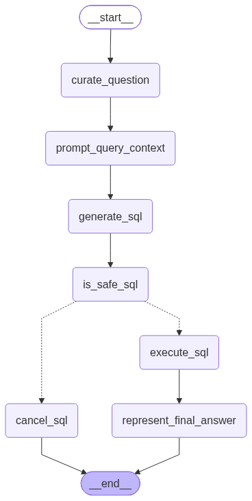
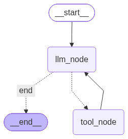

# 🤖 Data AI Agent — Intelligent SQL & ETL Automation

**Turn natural-language data requests into SQL insights and automated data workflows.**

Data AI Agent is a full-stack AI-powered data assistant that helps users interact with databases and automate Extract, Transform, and Load (ETL) workflows using natural language.

Instead of manually writing SQL queries or building repetitive data-processing scripts, users can describe what they want to accomplish. The agent intelligently routes each request to the appropriate specialized agent, executes the workflow, and returns a readable response.

Built with **Python, LangGraph, FastAPI, React, Vite, Tailwind CSS, and large language models**, Data AI Agent combines agentic AI orchestration with practical database analytics and data engineering workflows.

---

## 🌟 Overview

Working with data often requires switching between SQL editors, Python scripts, database tools, and data-processing pipelines.

Data AI Agent brings these tasks into a single conversational interface.

Users can ask questions about database contents, request analytical insights, extract information from APIs, transform datasets, remove duplicate records, and generate downloadable output files—all through natural-language instructions.

The application uses a LangGraph-based multi-agent architecture to distinguish SQL-related requests from ETL tasks and delegate them to specialized agents.

### ✨ What Can You Do?

- 🗄️ Ask questions about database tables using natural language.
- 🔎 Analyze database data with AI-generated SQL.
- 🛡️ Validate SQL requests before execution.
- 🌐 Extract data from public APIs and supported data sources.
- 🔄 Transform datasets using natural-language instructions.
- 🧹 Remove duplicate records and select specific columns.
- 📄 Generate CSV outputs from data-processing workflows.
- 📂 Download generated files directly from the interface.
- 🧠 Use specialized agents coordinated through LangGraph.
- 💬 Interact with the system through a modern conversational UI.
- 🔐 Isolate temporary output files by chat session.

## 🏗️ Multi-Agent Architecture

Data AI Agent is organized around a central router agent and two specialized sub-agents.

### 1. Data Agent — Intelligent Router

The main Data Agent receives the user's request and determines whether it is a SQL analytics task or an ETL workflow.

It delegates the task to the appropriate sub-agent and returns the resulting conversation to the user.

**Graph:** `data_agent_graph.png`


### 2. SQL Analyst Agent

The SQL Analyst specializes in database-related requests. Depending on the implemented workflow, it can interpret the question, prepare a database-aware query, validate the SQL response, execute the query, and generate a natural-language answer.

**Graph:** `sql_analyst_graph.png`



### 3. ETL Analyst Agent

The ETL Analyst handles data extraction and transformation workflows. It coordinates the relevant tools to locate extracted datasets, apply requested transformations, and save the processed results.

**Graph:** `etl_analyst_graph.png`



## 🔄 How It Works

The application follows a request-driven workflow.

1. **User request:** The user describes a data question or processing task in the chat interface.
2. **Request routing:** The Data Agent determines whether the task belongs to SQL analytics or ETL processing.
3. **Specialized execution:** The selected agent invokes its workflow and relevant tools.
4. **Data processing:** The system queries the database or extracts and transforms the requested data.
5. **Result generation:** The agent produces a readable answer and, for supported ETL workflows, saves output files.
6. **Result delivery:** The frontend displays the response and provides download links for available session files.

### Example: SQL Analytics

**User request**

> Show me the different payment methods in the database.

The SQL Analyst interprets the request and works through the database-analysis workflow to return relevant information.

### Example: ETL Extraction

**User request**

> Extract data from `https://pokeapi.co/api/v2/pokemon` and save it as CSV.

The ETL workflow retrieves data from the API and saves the extracted dataset.

### Example: ETL Transformation

**User request**

> Keep only the name and url columns and remove duplicate rows.

The ETL workflow loads the extracted dataset, applies the requested transformation, and produces a processed CSV file.

For example, the Pokemon API workflow can produce:

- `data/extract/extracted_data.csv`
- `data/transform/transformed_data.csv`

Actual output filenames and locations depend on the workflow configuration.

## 🧩 Key Features

### 🗄️ Natural-Language SQL Analytics

Interact with a database without manually composing every SQL statement.

The SQL workflow is designed to support tasks such as:

- Exploring available data.
- Answering questions about database records.
- Generating SQL queries from user requests.
- Checking whether a generated SQL response is acceptable.
- Executing database queries and interpreting the results.

Database connectivity and query behavior depend on the configured database and the implementation of the SQL Analyst.

### 🌐 API-Based Data Extraction

Extract data from supported HTTP APIs through conversational instructions.

Example:

`Extract data from https://pokeapi.co/api/v2/pokemon and save it as CSV.`

The extraction workflow can save the returned data for subsequent transformation.

### 🔄 Natural-Language Data Transformation

Describe the transformation you want rather than manually writing every data-processing step.

Examples include:

- Keep only selected columns.
- Remove duplicate records.
- Filter rows based on a condition.
- Prepare datasets for downstream analysis.
- Save transformed results as CSV files.

The available operations depend on the ETL tools and transformation logic configured in the project.

### 📂 Session-Based File Management

The backend organizes generated files by session.

The frontend can retrieve the files associated with the active chat and display download links for available outputs.

Session folders are intended for temporary storage and are subject to the configured cleanup policy. Files stored on temporary deployment disks may also disappear after a restart or redeployment.

### 💬 Interactive React Frontend

The frontend provides a conversational workspace for submitting data requests and viewing AI-generated responses.

It includes:

- A chat interface.
- Suggested example requests.
- Markdown-formatted assistant responses.
- A New Chat action.
- Session-specific output files.
- Download links for generated datasets.
- Loading and error feedback.

## 🛠️ Technology Stack

| Category | Technologies |
|---|---|
| Frontend | React, Vite, JavaScript |
| Styling | Tailwind CSS |
| Backend | Python, FastAPI, Uvicorn |
| Agent Orchestration | LangGraph |
| LLM Integration | LangChain, Groq, Google Gemini integrations |
| Data Processing | Pandas |
| Database Connectivity | PostgreSQL driver, Neon PostgreSQL configuration |
| API Communication | HTTPX / Requests, depending on the workflow |
| Validation | Pydantic |
| Session Storage | Python filesystem utilities and `ContextVar` |
| Version Control | Git, GitHub |
| Deployment | Render |

*Model providers and database integrations require the relevant credentials and configuration. The actual provider used depends on the application's settings.*

## 🏛️ System Architecture

```text
                  ┌────────────────────────┐
                  │       User             │
                  └───────────┬────────────┘
                              │
                              ▼
                  ┌────────────────────────┐
                  │   React + Vite UI       │
                  │   Tailwind CSS          │
                  └───────────┬────────────┘
                              │ HTTP / JSON
                              ▼
                  ┌────────────────────────┐
                  │     FastAPI Backend     │
                  │     main.py             │
                  └───────────┬────────────┘
                              │
                              ▼
                  ┌────────────────────────┐
                  │   Data Agent Router     │
                  │      LangGraph          │
                  └───────────┬────────────┘
                              │
                     ┌────────┴────────┐
                     │                 │
                     ▼                 ▼
          ┌──────────────────┐  ┌──────────────────┐
          │  SQL Analyst     │  │   ETL Analyst    │
          │                  │  │                  │
          └────────┬─────────┘  └────────┬─────────┘
                   │                     │
                   ▼                     ▼
          ┌──────────────────┐  ┌──────────────────┐
          │ PostgreSQL /     │  │ Extraction and   │
          │ SQL Execution    │  │ Transformation   │
          └────────┬─────────┘  └────────┬─────────┘
                   │                     │
                   ▼                     ▼
          ┌──────────────────┐  ┌──────────────────┐
          │ Query Results    │  │ Session CSV Files│
          └────────┬─────────┘  └────────┬─────────┘
                   │                     │
                   └──────────┬──────────┘
                              ▼
                  ┌────────────────────────┐
                  │   Answer / File Links   │
                  │      to Frontend        │
                  └────────────────────────┘
```

## 📁 Project Structure

```text
Ola_Data_Agent/
│
├── agents/
│   ├── data_agent.py
│   ├── sql_analyst.py
│   └── etl_analyst.py
│
├── models/
│   └── schema.py
│
├── utils/
│   ├── databse.py
│   ├── etl_tools.py
│   ├── llm_pick.py
│   └── session_storage.py
│
├── frontend/
│   ├── public/
│   ├── src/
│   │   ├── App.jsx
│   │   └── index.css
│   ├── package.json
│   ├── package-lock.json
│   └── .env
│
├── data_agent_graph.png
├── etl_analyst_graph.png
├── sql_analyst_graph.png
├── main.py
├── requirements.txt
├── .gitignore
└── README.md
```

*This structure illustrates the main files and folders. Keep the README consistent with the actual contents of your repository; omit or rename any paths that differ in your local project.*

## 🚀 Getting Started

### Prerequisites

Install the following before running the application:

- Python 3.11 or another version compatible with the installed dependencies.
- [uv](https://docs.astral.sh/uv/) for Python dependency and environment management.
- Node.js and npm.
- Git.
- API credentials for the LLM provider you use.
- Database credentials if you want to run SQL workflows against a remote PostgreSQL database.

### 1. Clone the Repository

```bash
git clone https://github.com/YOUR_USERNAME/Ola_Data_Agent.git
cd Ola_Data_Agent
```

Replace `YOUR_USERNAME` with your GitHub username.

### 2. Set Up the Python Environment with uv

Create and activate a virtual environment:

```bash
uv venv
```

On Windows PowerShell:

```powershell
.venv\Scripts\Activate.ps1
```

Install dependencies from the project's requirements file:

```bash
uv pip install -r requirements.txt
```

If the project is configured to use a `pyproject.toml` and `uv.lock`, you can instead use the corresponding `uv sync` workflow.

### 3. Configure Environment Variables

Create a `.env` file in the project root, alongside `main.py`.

Add the environment variables required by your implementation. For example:

```dotenv
GROQ_API_KEY=your_groq_api_key
GEMINI_API_KEY=your_gemini_api_key
DATABASE_URL=your_database_connection_string
```

These names are examples. Use the exact variable names read by your Python code, especially in `utils/llm_pick.py` and `utils/databse.py`.

**Important:** Never commit your actual `.env` file, API keys, or database credentials to GitHub.

### 4. Start the Backend

From the project root, run:

```bash
uv run uvicorn main:app --reload
```

The API will be available at:

`http://127.0.0.1:8000`

Health check:

`http://127.0.0.1:8000/health`

Expected response:

```json
{
  "status": "ok",
  "service": "Ola_Data_Agent"
}
```

Interactive API documentation:

`http://127.0.0.1:8000/docs`

### 5. Set Up the Frontend

Open a second terminal:

```bash
cd frontend
npm install
```

Create `frontend/.env` for local development:

```dotenv
VITE_API_BASE_URL=http://127.0.0.1:8000
```

Start the development server:

```bash
npm run dev
```

Open the local URL printed by Vite, usually:

`http://localhost:5173`

## ⚙️ Configuration

### Backend Environment

Configure secrets through your local `.env` file during development and through the deployment platform's environment settings in production.

| Setting | Purpose |
|---|---|
| LLM API key(s) | Authenticate with the configured language model provider |
| Database connection setting | Connect to the configured PostgreSQL database |
| `CORS_ORIGINS` | Allow the frontend origin to access the backend |

The exact environment variable names depend on the code in your repository.

### Frontend Environment

| Variable | Purpose |
|---|---|
| `VITE_API_BASE_URL` | Base URL used by the frontend to call the FastAPI backend |

For local development:

```dotenv
VITE_API_BASE_URL=http://127.0.0.1:8000
```

For production, set it to your deployed backend URL.

## ☁️ Deployment

Data AI Agent can be deployed using GitHub for source control and Render for hosting the backend and frontend.

### Backend — Render Web Service

Recommended settings:

| Setting | Value |
|---|---|
| Service type | Web Service |
| Runtime | Python |
| Root directory | Repository root |
| Build command | `pip install -r requirements.txt` |
| Start command | `uvicorn main:app --host 0.0.0.0 --port $PORT` |
| Health check path | `/health` |

Add the required LLM and database credentials in the Render environment settings.

Configure `CORS_ORIGINS` with the exact deployed frontend origin.

### Frontend — Render Static Site

Recommended settings:

| Setting | Value |
|---|---|
| Root directory | `frontend` |
| Build command | `npm install && npm run build` |
| Publish directory | `dist` |

Add the production environment variable:

```dotenv
VITE_API_BASE_URL=https://YOUR-BACKEND.onrender.com
```

Replace the example URL with the actual backend URL assigned by Render. After deploying the frontend, update the backend's `CORS_ORIGINS` value to the actual frontend URL.

For full deployment instructions, consult the [Render Web Services documentation](https://render.com/docs/web-services) and [Render Static Sites documentation](https://render.com/docs/static-sites).

**Deployment note:** Temporary session files are not durable storage. If you need permanent datasets or production-grade file persistence, integrate persistent storage or an object-storage service. Also, any model-generated Python executed by the backend must be sandboxed or replaced with safe, explicitly supported transformation operations before exposing the application publicly.

## 🔐 Security Considerations

- Never commit API keys, passwords, or database connection strings.
- Keep `.env` files out of version control.
- Use least-privilege database credentials.
- Restrict CORS to trusted frontend origins in production.
- Validate user requests and file paths.
- Apply limits to uploaded, extracted, and transformed data.
- Do not expose unrestricted model-generated Python execution to untrusted users.
- Use a proper sandbox if arbitrary code execution is required.
- Consider authentication, rate limiting, and resource limits before public release.

## 🧪 Example Prompts

Try these requests after configuring the appropriate integrations.

**Database analytics**
- "Show me the different payment methods in the database."
- "Summarize the important trends in this dataset."
- "Help me understand the records in the database."

**ETL extraction**
- "Extract data from `https://pokeapi.co/api/v2/pokemon` and save it as CSV."
- "Retrieve the data from this API and prepare it for analysis."

**ETL transformation**
- "Keep only the name and url columns and remove duplicate rows."
- "Clean the extracted dataset and save the transformed data as CSV."
- "Remove duplicate records and retain the columns I specify."

Available operations depend on the connected data source, model configuration, and implemented tools.

## 🎯 Use Cases

### 📊 Data Analytics
Explore database contents, ask business questions, and retrieve insights without manually writing every SQL query.

### 🔄 Data Engineering
Automate common extraction and transformation tasks using natural-language instructions.

### 🌐 API Data Collection
Retrieve information from supported APIs and save it in a reusable format.

### 🧹 Data Preparation
Select columns, remove duplicates, and prepare datasets for downstream analysis.

### 🎓 Learning and Experimentation
Explore how LangGraph, LLM-powered routing, tool calling, SQL, and Pandas can work together in a multi-agent application.

## 🔮 Future Improvements

Potential extensions include:

- CSV, Excel, and JSON upload support.
- Interactive dataset previews.
- Data profiling and quality reports.
- Schema discovery and SQL result visualizations.
- More deterministic transformation tools.
- Persistent object storage for generated files.
- User authentication and per-user workspaces.
- Background job tracking for long-running ETL tasks.
- Improved error handling and retry strategies.
- Sandboxed transformation execution.
- Automated tests and continuous integration.

## 🤝 Contributing

Contributions, bug reports, and suggestions are welcome.

1. Fork the repository.
2. Create a feature branch.
3. Implement and test your changes.
4. Commit your work.
5. Push the branch and open a pull request.

## 📜 License

Choose a license before distributing the project. If you intend to publish it as an open-source project, add an appropriate `LICENSE` file to the repository.

## ❤️ Data AI Agent

**Ask your data. Automate your workflows. Get insights faster.**

From natural-language SQL analytics to practical ETL automation, Data AI Agent brings data interaction and AI-driven workflows into one conversational workspace.
